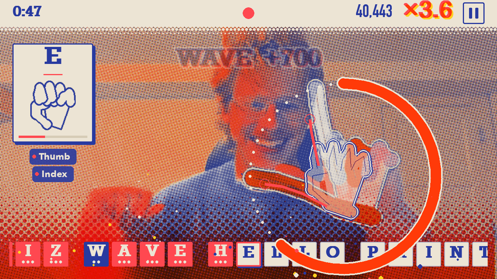
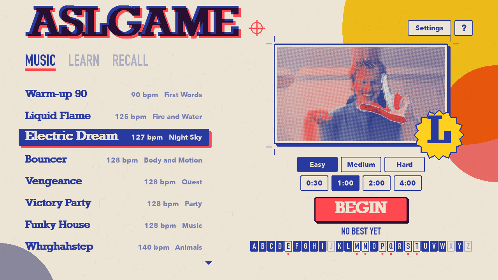
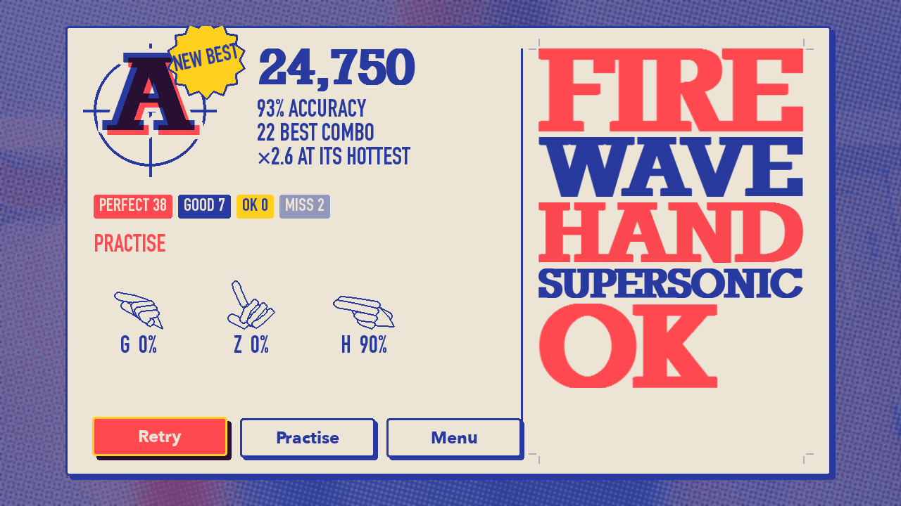
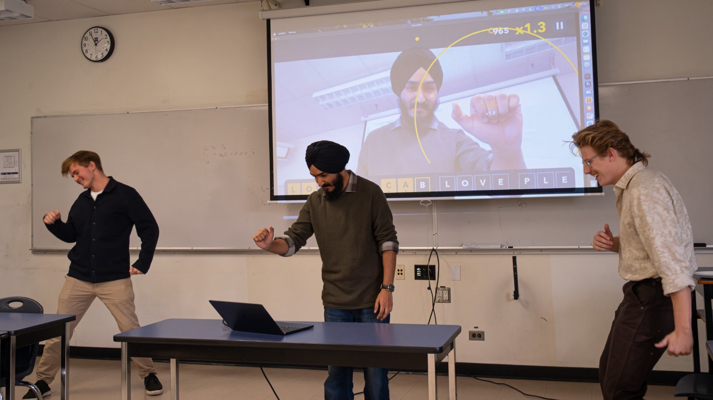

# ASLGAME

Learn the ASL alphabet by signing along to music.







The three pictures above are rendered from the game over a still photo. The photo below is from an earlier version.



Apps like Duolingo work well for spoken languages but leave out visual ones like American Sign Language. ASLGAME is a music game in the spirit of osu!: your webcam watches your hand, a target handshape appears over it, and you spell words to a song, one letter at a time. The goal is to bring movement, music, and play into learning ASL, in a classroom or at home.

Runs locally.

Developed for BEC 2026

## Install

You need a webcam and about 650 MB of free space: Python, the game's libraries (MediaPipe, OpenCV, NumPy, pygame), and the game with its songs. Setup downloads everything it needs the first time it runs.

### Mac

Needs Apple Silicon (M1 or newer). Open Terminal, paste this line, and press Return:

```
git clone https://github.com/DeanMenkis/ASLGAME.git ~/ASLGAME && ~/ASLGAME/ASLGAME.command
```

The first run takes a few minutes to set up, then the game opens. Allow camera access when macOS asks. To play again later, double-click `ASLGAME.command` in the `ASLGAME` folder in your home folder.

If macOS asks to install developer tools when you run the line, click Install, then run the line again.

### Windows (untested)

Windows support has not been tested yet. If you try it, please report what happens.

Open PowerShell, paste this line, and press Return:

```
irm https://github.com/DeanMenkis/ASLGAME/archive/refs/heads/main.zip -OutFile $env:TEMP\aslgame.zip; Expand-Archive $env:TEMP\aslgame.zip $HOME -Force; & $HOME\ASLGAME-main\ASLGAME.bat
```

The first run takes a few minutes to set up, then the game opens. To play again later, double-click `ASLGAME.bat` in the `ASLGAME-main` folder in your user folder.

## Modes

- **Music**: sign along to a song. Each letter has a fuse a few beats long; sign it before the fuse runs out, and the next letter appears at once. Faster signs score better, and a sign that lands on a beat scores more.
- **Learn**: untimed. Match each handshape at your own pace.
- **Recall**: untimed and harder. Only the letter is shown; sign it from memory.

The game remembers how well you sign each letter. The alphabet in the menu shows which letters you know and which need work, and the Practise deck deals words that use your weak letters: pick it in Learn or Recall, or press Practise after a song.

Timing cues are always visual. Sound is never required to play.

## Contributors

ASLGAME is built by its human team together with Claude Code by Anthropic, which wrote much of the code and docs throughout development. Commits Claude worked on carry a `Co-Authored-By: Claude` line, so Claude appears in the GitHub contributor list. See [Credits](docs/CREDITS.md).

## Docs

These docs are for contributors, both people and AI coding assistants such as Claude Code, which read them for project context. Players only need the sections above.

- [How it works](docs/HOW_IT_WORKS.md): start here, a one-minute overview
- [Design](docs/DESIGN.md): the design principles behind the interface
- [Developer notes](docs/DEVELOPING.md): tools, tests, and debug keys
- [Coding standards](docs/CODING_STANDARDS.md): how the code is written
- [Architecture](docs/ARCHITECTURE.md): how the program is shaped
- [Roadmap](docs/ROADMAP.md): what's done, what's next
- [Decisions](docs/DECISIONS.md): why the project works the way it does
- [Credits](docs/CREDITS.md): sources, models, libraries, AI use
- [Accessibility](docs/ACCESSIBILITY.md): cues, options, and known gaps

## Scope and limits

The letter shapes come from a public dataset and have not yet been checked by a fluent signer. Corrections are very welcome.

This is a learning tool, not a translator. It supports the fingerspelled alphabet (J and Z by their drawn path) and does not understand word signs, full ASL grammar, or facial expression. See the roadmap for what is currently supported.

## License

The code is under the [MIT License](LICENSE). Songs, the hand tracking model, and the letter data keep their own licenses; see [Credits](docs/CREDITS.md).
